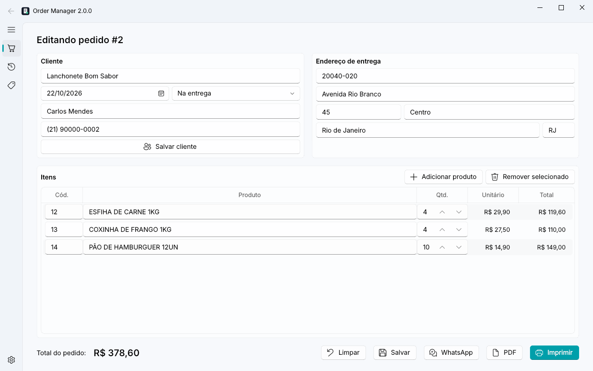
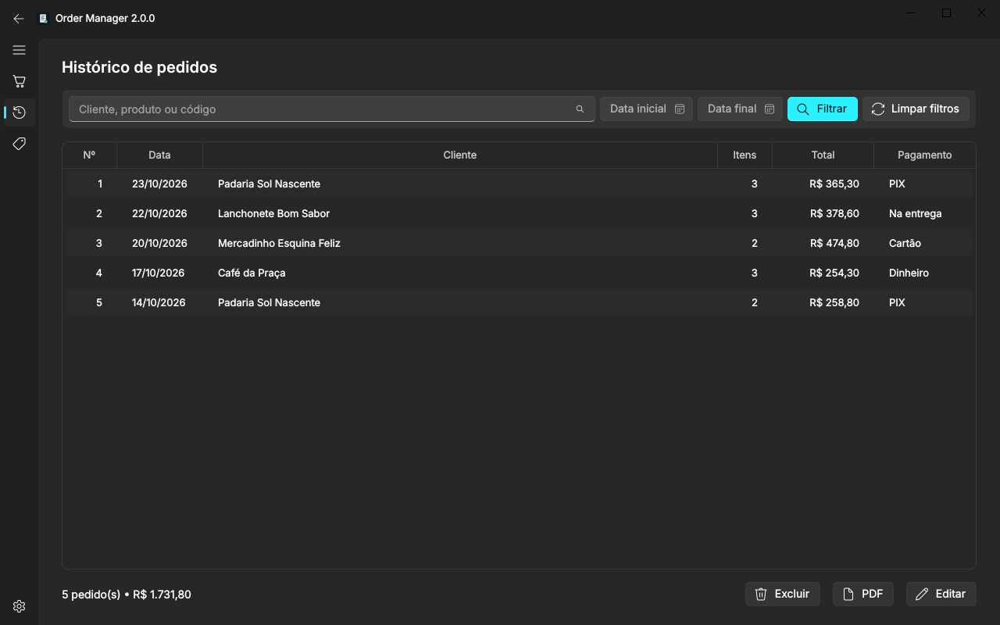
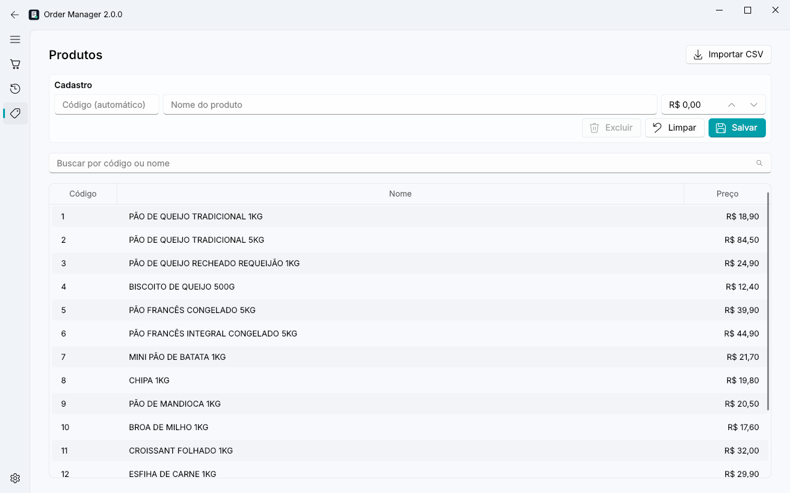
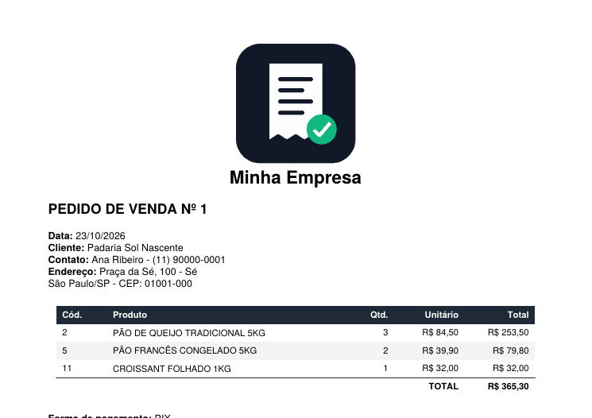
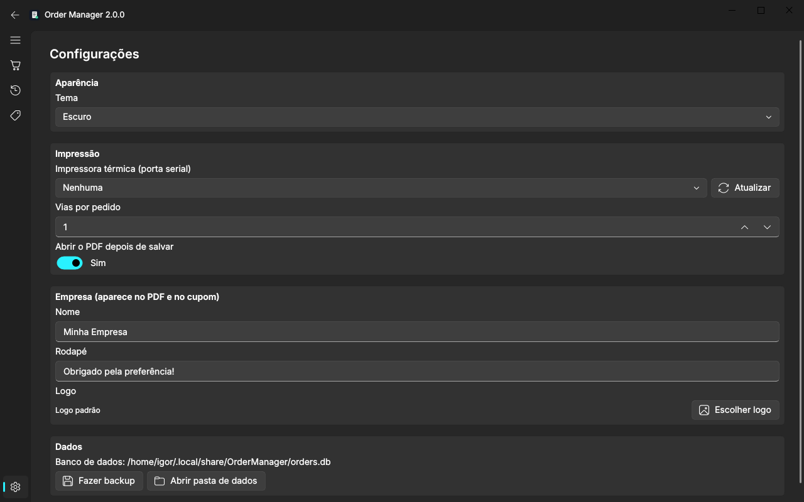
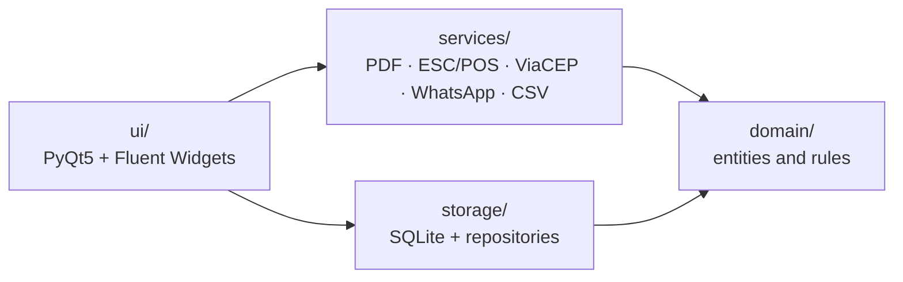

<div align="center">


# Order Manager

**Desktop order entry and management for small wholesale distributors**

[](https://github.com/igorparreirap/order-manager/actions/workflows/ci.yml)


[](https://github.com/astral-sh/ruff)
[](LICENSE)

**English** | [Português](README.pt-BR.md)



</div>

## About

I built Order Manager to solve a real problem: a frozen-bread distributor wrote orders by hand and then
re-typed them into WhatsApp and a receipt printer. The app puts that whole workflow on one screen. The
salesperson types the customer, finds products by code or name, and the order goes out as a PDF, a
thermal-printer receipt or a ready-to-send WhatsApp message.

This is **version 2**, a complete rewrite of the first version I used in production. The
[CHANGELOG](CHANGELOG.md) lists the bugs it fixed and the architectural changes. The UI is in Brazilian
Portuguese, since that is who uses it; the code and documentation are in English.

> All data in this repository (customers, products and prices) is **fictitious**.

## Features

- 🧾 **Orders**: create and edit orders, with customer/product autocomplete and a live total
- 📍 **ZIP lookup**: fills in the address automatically from the public [ViaCEP](https://viacep.com.br) API
- 🖨️ **Thermal printing**: 80 mm ESC/POS receipts over a serial port, with logo and multiple copies
- 📄 **PDF**: A4 document with automatic pagination
- 💬 **WhatsApp**: opens a chat with the customer, pre-filled with the order summary
- 🔎 **History**: search by customer, product or code, filter by date range, period total
- 🏷️ **Products**: catalogue management and CSV import (including cp1252 files from Excel on Windows)
- 🌗 **Light and dark themes**, one-click database backup and configurable company details

| History (dark theme) | Products |
|---|---|
|  |  |

| Generated PDF | Settings |
|---|---|
|  |  |

## Getting started

Requires **Python 3.10+**.

```bash
git clone https://github.com/igorparreirap/order-manager.git
cd order-manager
python -m venv .venv
# Windows: .venv\Scripts\activate  |  Linux/macOS: source .venv/bin/activate
pip install -e .

order-manager seed-demo   # optional: creates fictitious data to explore the app
order-manager             # launches the app
```

To import a product catalogue from the command line:

```bash
order-manager import-products products.csv --price-column preco --delimiter ";"
```

Data is stored in the user data directory (`%LOCALAPPDATA%\OrderManager` on Windows). For a portable
setup, point the `ORDER_MANAGER_HOME` environment variable to another folder.

## Architecture

The code is organised in layers, and dependencies only point inwards: the UI knows the services and
repositories, and the domain depends on nothing else.



```
src/order_manager/
├── domain/        # Entities (Order, Product, Customer…), validation and formatting. No I/O.
├── storage/       # SQLite connection, versioned migrations and repositories
├── services/      # PDF, thermal printer, ZIP lookup, WhatsApp, CSV import and backup
├── ui/            # Main window and pages; pages talk to each other through Qt signals
├── context.py     # Dependency injection: a single instance of each service
└── __main__.py    # CLI: opens the GUI, imports products or creates demo data
```

### Technical decisions

| Decision | Why |
|---|---|
| **SQLite** instead of JSON files | Transactions save an order and its items together or not at all, and one screen can no longer overwrite another screen's data. |
| **`Decimal` money stored as integer cents** | `0.1 + 0.2 != 0.3` with floats. Money has to be exact. |
| **Migrations with `PRAGMA user_version`** | A database created by an older version is upgraded automatically on startup. |
| **Accent-insensitive search** via a function registered in SQLite | "pao" finds "PÃO DE QUEIJO". |
| **Receipt layout separated from transport** | `print_receipt` accepts any python-escpos printer, so the tests use the `Dummy` printer instead of hardware. |
| **ZIP lookup in a `QThread`** | Network calls never freeze the UI. |
| **`AppContext`** | Every screen shares the same database and settings instances. |

## Tests and quality

```bash
pip install -e ".[dev]"
pytest --cov          # 79 tests, ~97% coverage outside the UI layer
ruff check . && ruff format --check .
```

The suite covers the domain, the repositories (including transaction rollback), the services (with
ViaCEP mocked) and UI smoke tests that run headless with `QT_QPA_PLATFORM=offscreen`. CI runs lint and
tests on Linux (Python 3.10 to 3.13) and on Windows for every push.

## Roadmap

- [ ] Windows installer built with PyInstaller and published in Releases
- [ ] Sales reports by period and by product
- [ ] Multiple price lists per customer
- [ ] USB and network thermal printers, in addition to serial

## License

[MIT](LICENSE) © Igor Parreira de Paula
