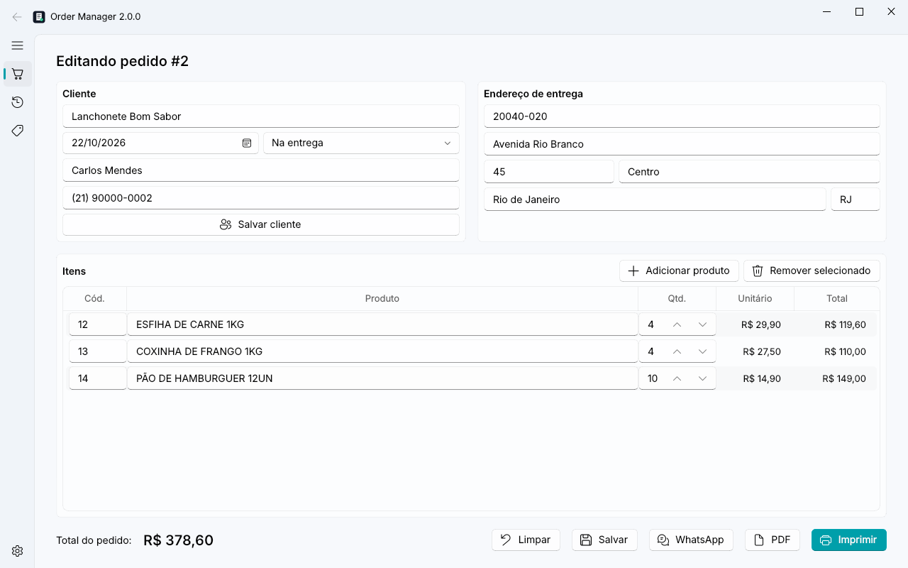
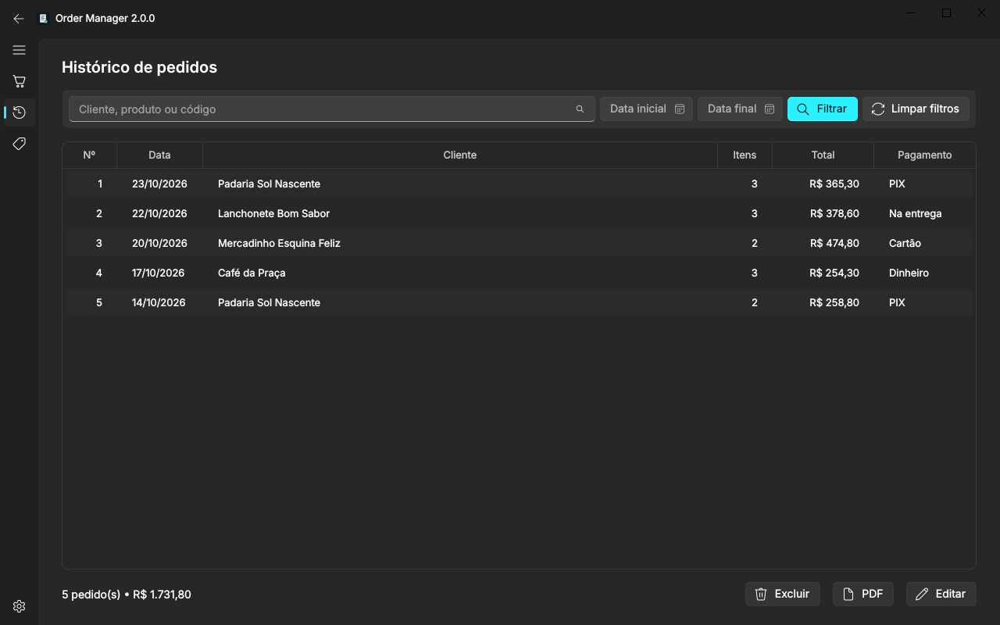
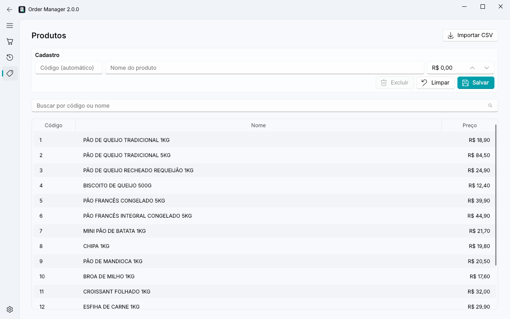
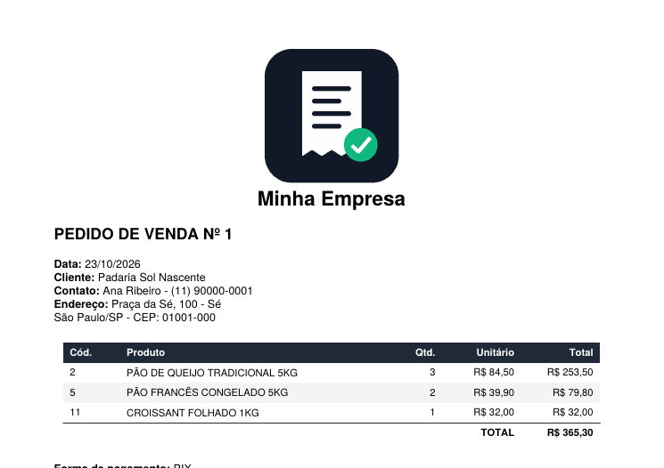
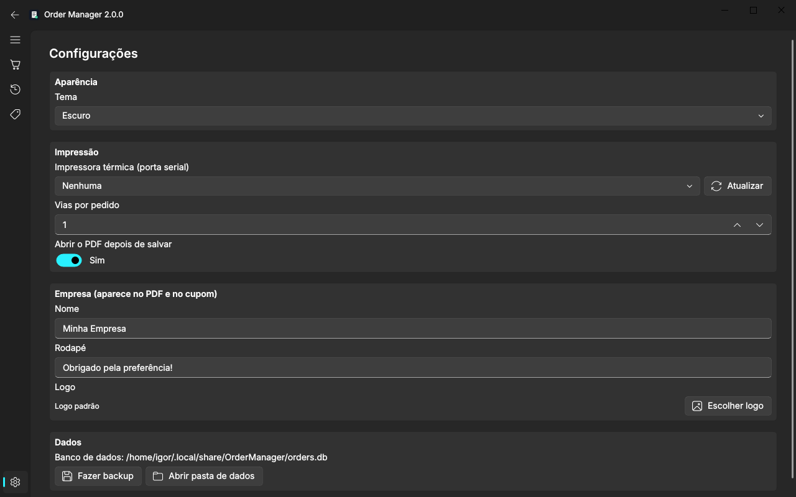
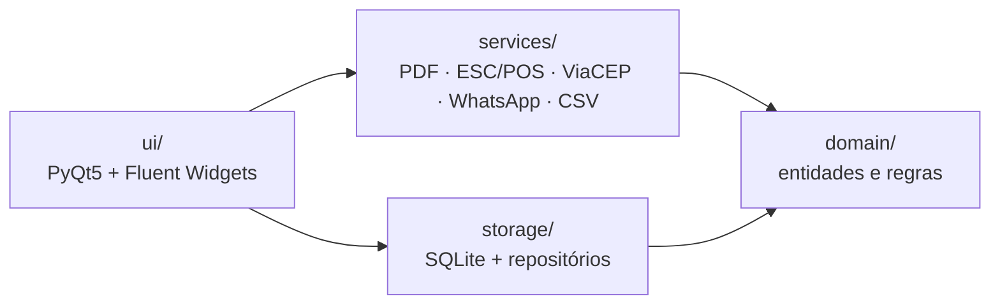

<div align="center">


# Order Manager

**Sistema desktop de emissão e gestão de pedidos para pequenas distribuidoras**

[](https://github.com/igorparreirap/order-manager/actions/workflows/ci.yml)


[](https://github.com/astral-sh/ruff)
[](LICENSE)

[English](README.md) | **Português**



</div>

## Sobre o projeto

Criei o Order Manager para resolver um problema real: uma distribuidora de pães congelados anotava pedidos
à mão e depois repassava tudo para o WhatsApp e para a impressora. O sistema concentra esse fluxo em uma
única tela. O vendedor digita o cliente, busca os produtos pelo código ou pelo nome, e o pedido sai em PDF,
no cupom da impressora térmica ou em uma mensagem pronta no WhatsApp.

Esta é a **versão 2**, uma reescrita completa da primeira versão que usei em produção. O
[CHANGELOG](CHANGELOG.md) lista os bugs corrigidos e o que mudou na arquitetura.

> Os dados deste repositório (clientes, produtos e preços) são **fictícios**.

## Funcionalidades

- 🧾 **Pedidos**: emissão e edição, com autocompletar de clientes e produtos e total calculado na hora
- 📍 **CEP**: preenche o endereço automaticamente pela API pública do [ViaCEP](https://viacep.com.br)
- 🖨️ **Impressão térmica**: cupom ESC/POS de 80 mm pela porta serial, com logo e várias vias
- 📄 **PDF**: documento A4 com paginação automática
- 💬 **WhatsApp**: abre a conversa com o cliente já com o resumo do pedido
- 🔎 **Histórico**: busca por cliente, produto ou código, filtro por período e total do período
- 🏷️ **Produtos**: cadastro e importação de planilhas CSV (inclusive arquivos do Excel no Windows)
- 🌗 **Tema claro e escuro**, backup do banco com um clique e dados da empresa configuráveis

| Histórico (tema escuro) | Produtos |
|---|---|
|  |  |

| PDF gerado | Configurações |
|---|---|
|  |  |

## Como executar

Requisitos: **Python 3.10+**.

```bash
git clone https://github.com/igorparreirap/order-manager.git
cd order-manager
python -m venv .venv
# Windows: .venv\Scripts\activate  |  Linux/macOS: source .venv/bin/activate
pip install -e .

order-manager seed-demo   # opcional: cria dados fictícios para explorar o app
order-manager             # abre o aplicativo
```

Para importar um catálogo de produtos pela linha de comando:

```bash
order-manager import-products produtos.csv --price-column preco --delimiter ";"
```

Os dados ficam na pasta de dados do usuário (`%LOCALAPPDATA%\OrderManager` no Windows). Para um uso
portátil, defina a variável `ORDER_MANAGER_HOME` com outra pasta.

## Arquitetura

O código é organizado em camadas. As dependências apontam sempre para dentro: a interface conhece os
serviços e os repositórios, e o domínio não conhece ninguém.



```
src/order_manager/
├── domain/        # Entidades (Order, Product, Customer…), validação e formatação. Sem I/O.
├── storage/       # Conexão SQLite, migrações versionadas e repositórios
├── services/      # PDF, impressora térmica, CEP, WhatsApp, importação CSV e backup
├── ui/            # Janela principal e páginas; comunicação entre páginas por sinais Qt
├── context.py     # Injeção de dependências: uma única instância de cada serviço
└── __main__.py    # CLI: abre a interface, importa produtos ou cria dados de demonstração
```

### Decisões técnicas

| Decisão | Motivo |
|---|---|
| **SQLite** em vez de JSON | Transações garantem que o pedido e os itens são gravados juntos (ou nenhum deles). Também acabou o problema de uma tela sobrescrever os dados de outra. |
| **`Decimal` e centavos inteiros** | `0.1 + 0.2 != 0.3` com `float`. Dinheiro precisa ser exato. |
| **Migrações com `PRAGMA user_version`** | Um banco criado por uma versão antiga é atualizado automaticamente quando o programa abre. |
| **Busca sem acentos** com função registrada no SQLite | "pao" encontra "PÃO DE QUEIJO". |
| **Layout do cupom separado do transporte** | `print_receipt` aceita qualquer impressora do python-escpos, então os testes usam a impressora `Dummy`, sem hardware. |
| **Consulta de CEP em `QThread`** | Chamadas de rede não travam a interface. |
| **`AppContext`** | Todas as telas compartilham as mesmas instâncias de banco e configurações. |

## Testes e qualidade

```bash
pip install -e ".[dev]"
pytest --cov          # 79 testes; ~97% de cobertura fora da camada de UI
ruff check . && ruff format --check .
```

A suíte cobre o domínio, os repositórios (incluindo rollback de transação), os serviços (com o ViaCEP
simulado) e testes de fumaça da interface, que rodam sem tela usando `QT_QPA_PLATFORM=offscreen`. O CI
roda lint e testes no Linux (Python 3.10 a 3.13) e no Windows a cada push.

## Próximos passos

- [ ] Instalador para Windows com PyInstaller, publicado nas Releases
- [ ] Relatório de vendas por período e por produto
- [ ] Mais de uma tabela de preço por cliente
- [ ] Impressoras térmicas USB e de rede, além da serial

## Licença

[MIT](LICENSE) © Igor Parreira de Paula
